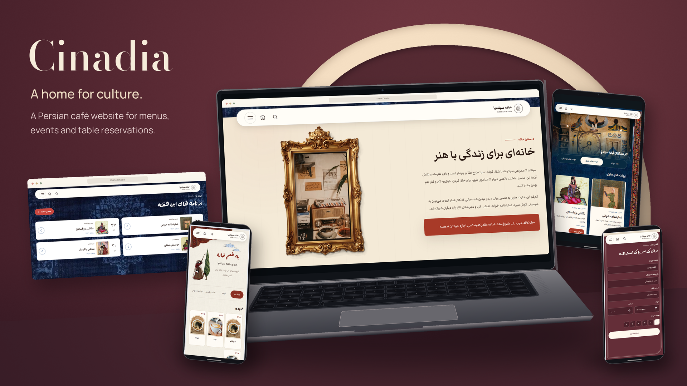

# Khane Cinadia

A Persian RTL cafe website for Khane Cinadia, a warm neighborhood space for coffee, conversation, reading, and intimate cultural events.

<p align="center">

</p>

## Features

- RTL Persian interface with a nostalgic Iranian visual direction
- Coffee shop menu with coffee, drinks, cakes, and pastries
- Featured menu with 14 popular items and a separate menu.html page with the confirmed menu
- Upcoming live music, poetry, and coffee workshop events
- Cafe story section and image-led editorial layout
- Reservation request form for tables and events
- Responsive layout for desktop and mobile screens
- Accessible navigation, labels, focus states, and reduced-motion support

## Cinematic Build

The production `index.html` and the standalone page in `cafe-menu-events-main/` both serve the cinematic experience. One muted video element is reused for the intro and hero. The optimized H.264 intro is 488 KB, with a 45 KB WebP poster; this makes its first frame available quickly on slower connections. Reduced-motion visitors receive a paused intro video. The 357 KB story video loads when it approaches the viewport, pauses when out of view, and stays paused for reduced-motion visitors unless they choose playback. Both pages share the same video and poster assets. Menu, home, and store entry actions are available, and Escape remains the keyboard exit.

Scrolling expands the darkened hero video across the entire viewport behind the header, logo, and navigation. The Persian sentence “سینا و نادیا / یک زوج هنری” is centered independently over it. Reduced motion keeps this composition static with manual playback available.

## Tech Stack

The November 26 performance pass adds responsive WebP menu/event images, locally hosted WOFF2 fonts, deferred event-category images and cached hero animation geometry. See [PERFORMANCE.md](PERFORMANCE.md) for exact before/after asset sizes and verification scope.

This lightweight static website uses HTML5, CSS3, and vanilla JavaScript. Images are loaded from Unsplash. No build step or package installation is required.

## Run Locally

From the repository root, serve the cinematic build:

```powershell
python -m http.server 8000
```

Then open http://localhost:8000. The root entry uses the same tested cinematic build as the standalone folder. See `cafe-menu-events-main/README.md` for the video lifecycle, fallback, accessibility, and asset details.

## Project Structure

- `index.html` - production entry for GitHub Pages, referencing the shared cinematic assets
- `cafe-menu-events-main/index.html` - standalone entry with folder-relative asset paths
- `cafe-menu-events-main/styles.css` - shared visual system, layout, and responsive styles
- `cafe-menu-events-main/script.js` - shared video, hero, navigation, menu, and reservation interactions
- `cafe-menu-events-main/assets/media/cinadia-hero.mp4` - supplied cinematic video
- Root-level `styles.css` and `script.js` - earlier files retained for reference; not loaded by the production entry

The two HTML entries contain the same page content. When updating the standalone entry, keep the root entry synchronized and prefix its three local asset paths with `cafe-menu-events-main/`.

## Shared responsive navigation

The house, menu, events, and jewelry shop share `cafe-menu-events-main/shared-header.js` and `shared-header.css`, including the standalone café entries and the retained shop test page. The menu button remains visible beside the home and search controls at every width, with its icon and accessible label reflecting whether navigation is open. Below 700px it opens a viewport-constrained dropdown, choosing above or below the header according to available space. Escape restores focus to the button; outside clicks, link selection, and opening search dismiss the mobile menu. Search and navigation never remain open together. Resizing clears the mobile state. At 700px and above, the button manually opens or closes the existing single-row navigation below the header; downward scrolling still hides that row, while upward scrolling or keyboard focus restores it. Reduced motion disables navigation transitions. The shop keeps its gallery search, gallery contact, category routes, and collection controls.

## Jewelry store preview

Open `shop.html` for the Sinadia jewelry category page. Both café intro “فروشگاه” links open this route. It uses the approved sapphire / cream reference, exactly four reusable arched category cards, and local Markazi Text fonts. Category links are bookmarkable through `?category=necklaces`, `rings`, `bracelets`, and `earrings`.

Shop styling uses locally compiled Tailwind CSS, with `shop:` utilities, no global Preflight, and one shared SVG architectural arch for image clipping and gold outlines. To change Shop styling, run the following from the repository root:

```powershell
npm ci
npm run build
```

Use `npm run watch:shop` while editing. The generated `cafe-menu-events-main/shop.css` is committed and served directly; visitors and the café/menu/events pages need no Node runtime. The only Tailwind development dependencies are exact matching versions 4.3.5 of `tailwindcss` and `@tailwindcss/cli`.

No product inventory or prices were supplied. Each category currently provides its own collection heading and a link to the existing gallery Instagram for current models and availability. See `SHOP-DESIGN.md` for the route's visual contract and `assets/jewelry/PROVENANCE.md` for the reference-image crop sources and their resolution limits.

## Live Demo

https://mahanmzi-git.github.io/cafe-menu-events/

## Reservation Note

The reservation form is currently a front-end demo. It shows local confirmation feedback and does not send or store real reservations.

## License

This project is provided for the Khane Cinadia website concept.

The latest compact-navigation, dedicated-menu, hero-text-fit, and blue-event updates were checked in Chromium at 320, 390, 563, and 1440 CSS pixels. All 14 prices, menu navigation, return links, video text bounds across four scroll positions, and menu-page overflow passed; no JavaScript errors were reported. External stock images may fail when their host is unavailable.
